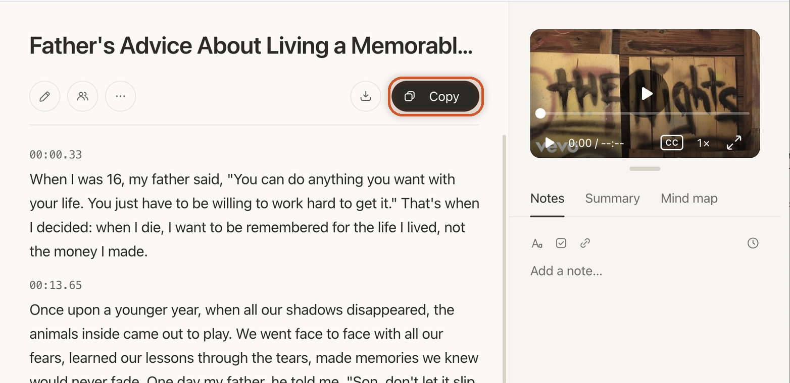
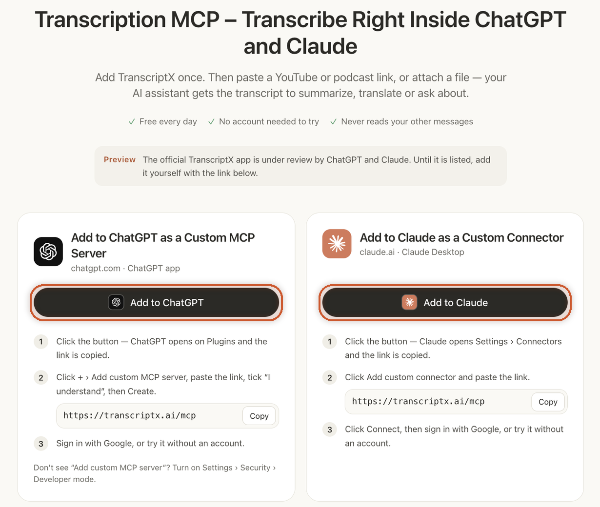
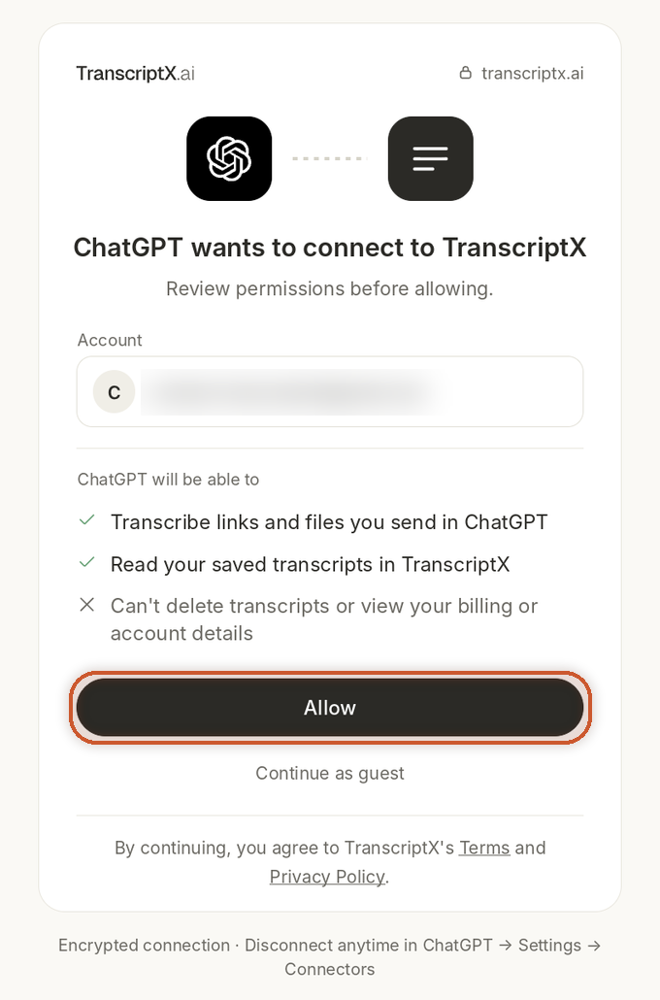

# Can ChatGPT Watch Videos? Here's How to Make It Read Them

> **Quick answer:** No. ChatGPT can't watch a video or listen to its audio. Paste a YouTube link and it either can't get the content at all or works from the title and description. It works with text. Give it the transcript and it can answer questions about every word. The quickest way is to add [TranscriptX's Transcription MCP](/transcription-mcp/) to ChatGPT or Claude, then paste a link and ask.

You paste a YouTube link into ChatGPT and ask what the speaker said about pricing. Either it tells you it can't open the video, or it answers fast and confident, and when you watch the video you realize half of it was never said.

That happens because ChatGPT can't watch videos. It reads text. If the words spoken in the video never reach the chat, the assistant fills the gap with what it can see: the title, the description, or a good guess.

This guide explains what ChatGPT and Claude can and can't do with a video, the two workarounds people have used so far, and a newer way: connecting TranscriptX to the chat so the assistant gets the full transcript on its own.

## Can ChatGPT Watch Videos?

Not in the way you'd hope. ChatGPT can't play a video, follow it from start to finish, or hear what people say in it. What it works with is text and, in some cases, still images.

So the question to ask is really this: **can ChatGPT get the words that were spoken in the video?** On its own, usually not.

- **From a link:** at best, it reads the page around the video, such as the title, the description and sometimes the comments. The audio isn't part of that.
- **From an uploaded video file:** it may be able to look at some frames, but the speech itself isn't turned into text for it to read.

Either way, the spoken content, which is most of what a talk, lecture, podcast or tutorial is about, never reaches the chat.

## Can ChatGPT Watch YouTube Videos? What Happens When You Paste a Link

When you paste a YouTube link, a few things can happen:

1. **ChatGPT reads the page, not the video.** If it can open the link, it gets the title, the description and other text on the page.
2. **It answers from that text.** If the description is detailed, the answer can sound right. If it's short, the assistant guesses from the title and what it knows about the topic.
3. **It may not say it's guessing.** That's the real problem. You get an answer about the video, but not one built from the video.

In our test on the free ChatGPT plan, we pasted a YouTube music video link and asked for a summary. ChatGPT was honest about it: "I can summarize the YouTube video for you, but I couldn't retrieve its actual content from the link." Then it asked us to get a transcript and paste it in.

This is why people searching "can ChatGPT access YouTube videos" or "can ChatGPT open YouTube links" get mixed results. Opening the page isn't the same as hearing what was said.

## Can ChatGPT Analyze Videos? It Needs the Words First

Most of what people want from a video is in the speech: the argument of a lecture, the steps in a tutorial, the quote from an interview, the decisions in a recorded meeting. To analyze that, ChatGPT needs a **transcript**, the full text of everything that was said.

With a transcript, ChatGPT can analyze the video the way it analyzes any document:

- Answer questions about specific parts.
- Find quotes and tell you roughly where they are, if the transcript has timestamps.
- Translate what was said.
- Turn a long talk into notes, steps or a short list of points.

A transcript has one limit worth knowing. It covers what was **said**, not what was **shown**. Text on slides, charts or anything that happens without speech won't be in it. For talks, podcasts, lectures and interviews, that's rarely a problem.

## Two Workarounds People Have Used So Far

Until now there were two ways to get a video into ChatGPT.

### 1. Describe the video yourself

You watch the video, then explain it to ChatGPT in your own words. That works for a two-minute clip. For an hour-long lecture, it defeats the point of asking an AI in the first place, and the answer is only as good as your notes.

### 2. Copy the transcript and paste it in

This is the reliable way, and it works with any AI assistant:

1. Open the [YouTube Transcript](/youtube-transcript/) page on TranscriptX and paste the video link into **Paste a YouTube video URL...**.
2. Click the arrow button. The transcript appears in a few seconds, split into paragraphs with timestamps.
3. Click **Copy** to copy the whole transcript, timestamps included.
4. Paste it into ChatGPT and ask your question.

It works well, but it takes a few steps for every single video: another tab, copy, switch back, paste. With long videos, the pasted text also fills a lot of the chat.

## The New Way: Connect TranscriptX to ChatGPT and Claude

TranscriptX now works **inside** ChatGPT and Claude through a **Transcription MCP**. You add it once, then paste a link in the chat, and the assistant gets the transcript on its own. No other tab, no copy and paste.

MCP (Model Context Protocol) is the standard way AI assistants connect to outside tools. In plain terms: you give ChatGPT or Claude a new skill. With TranscriptX added, that skill is "turn this video or audio into text."

Here's what the assistant can do with it:

- **Transcribe a link** you paste in the chat.
- **Transcribe a file** you attach in ChatGPT or upload in Claude.
- **Read a finished transcript in parts**, so it can work through a long video.

The official app is still under review by ChatGPT and Claude. Until it's listed, you add it yourself with the server link. It takes about a minute.

## 🎬🎬🎬 ĐỂ VIDEO Ở ĐÂY 🎬🎬🎬

### How to add TranscriptX to ChatGPT

1. Open the [Transcription MCP](/transcription-mcp/) page and click **Add to ChatGPT**.
2. ChatGPT opens the TranscriptX plugin page. Click **Install plugin**.
3. A TranscriptX window asks you to review what ChatGPT can do: transcribe the links and files you send, and read your saved transcripts. It can't delete transcripts or see your billing or account details. Click **Allow**, or **Continue as guest** if you don't want to sign in.

We set this up on the free ChatGPT plan. If ChatGPT asks you to add the server by hand instead, choose **Add custom MCP server**, paste `https://transcriptx.ai/mcp`, tick "I understand" and click **Create**. If that option is missing, turn on **Developer mode** under Settings › Security.

## Can Claude Watch Videos?

Claude has the same limit as ChatGPT. It reads text, documents and images, but it can't watch a video or listen to the audio from a YouTube link. Ask Claude about a video and it either tells you it can't see it or works from whatever text it can find.

The fix is the same too: give Claude the transcript. The TranscriptX connector works on claude.ai and in the Claude Desktop app.

### How to add TranscriptX to Claude

1. Open the [Transcription MCP](/transcription-mcp/) page and click **Add to Claude**. Claude opens its connector settings and the link is copied for you.
2. Choose **Add custom connector** and paste the link.
3. Click **Connect**, then sign in with Google, or try it without an account.

## How to Get ChatGPT to Watch a YouTube Video

Once TranscriptX is connected, using it is just a message. Pick **TranscriptX** in the chat box, paste the link and say what you want:

- *"Transcribe this video: https://www.youtube.com/watch?v=..."*
- *"What does the speaker say about pricing in this video? [link]"*
- *"List the steps in this tutorial: [link]"*
- *"Translate what's said in this interview into Spanish: [link]"*
- *"Find the part where they talk about the release date: [link]"*

The assistant sends the link to TranscriptX, and a card appears in the chat with the video title, its length and language, and the transcript with timestamps. The card has an **Edit** button, an **Export** button for .txt, .srt or .vtt, and a separate **Copy transcript** button. In our test, a 3-minute YouTube video was processed in about 8 seconds.

Then the assistant answers your question from the text that was actually spoken, not from the title.

Want to upload a video to ChatGPT instead of sharing a link? Attach the audio or video file in ChatGPT, or upload it in Claude, and ask the same way. TranscriptX transcribes the file and the assistant works from the text.

## What Can You Transcribe Inside the Chat?

The connector takes the same sources as the TranscriptX website:

- **YouTube** links, from any public video.
- **TikTok, Instagram and X** links.
- **Podcasts** and direct media URLs.
- Shared **Google Drive, Dropbox and OneDrive** links.
- **Audio and video files** attached in ChatGPT or uploaded in Claude.

Private or removed videos can't be transcribed, because there's nothing public to open.

## Is It Free, and Does It Read My Chats?

**It's free every day.** Guests and free accounts get a daily allowance, and you can try it without an account. Very long recordings may go over the free limits. The Pro plan raises most limits. Nothing is bought inside the chat.

**It doesn't read your conversation.** TranscriptX only receives the link or file you ask it to transcribe. It never sees your other messages, and it can't delete your transcripts or see your billing or account details. Uploaded files are deleted within 12 hours, and you can disconnect TranscriptX at any time from ChatGPT or Claude settings.

## Copy and Paste or Connector: Which One to Use

| | Copy and paste the transcript | TranscriptX connector |
|---|---|---|
| Works in | Any AI assistant | ChatGPT and Claude |
| Setup | None | Once, about a minute |
| Steps per video | Open TranscriptX, paste link, Copy, paste in chat | Paste the link in the chat |
| Long videos | Fills the chat with text | The assistant reads the transcript in parts |
| Files | Upload to TranscriptX, then copy | Attach or upload in the chat |
| Export TXT, SRT, VTT | Yes, from the TranscriptX page | Yes, from the result in the chat |
| Price | Free every day | Free every day |

**Our advice:** if you use ChatGPT or Claude often to work with videos, add the connector once and stop switching tabs. If you use another assistant, or only need one video, copy and paste the transcript from the [YouTube Transcript](/youtube-transcript/) page.

## Frequently Asked Questions

### Can ChatGPT summarize a YouTube video?

Only reliably if it has the transcript. From a link alone, it often summarizes the title and description instead of the video. With TranscriptX connected, paste the link and ask for a summary, and it works from what was actually said. You can also do it on the TranscriptX website: see [how to summarize a YouTube video](/blog/how-to-summarize-a-youtube-video/).

### Can ChatGPT open YouTube links?

It may open the page, but that gives it the title and description, not the speech in the video. To work with what was said, it needs the transcript.

### Is there an AI that can watch YouTube videos?

Some assistants have their own ways to handle YouTube. For example, Google's Gemini has a built-in YouTube integration. ChatGPT and Claude don't get the spoken words from a link on their own, and that's the gap the TranscriptX connector fills.

### Can Claude watch YouTube videos?

Not on its own. Add the TranscriptX connector on claude.ai or Claude Desktop, then paste the link. Claude gets the full transcript and answers from it.

### Do I need an account to use the TranscriptX connector?

No. You can try it without an account. Signing in with Google keeps your transcripts in your TranscriptX history, on every device.

### Does it work with uploaded video files?

Yes. Attach an audio or video file in ChatGPT, or upload it in Claude, and ask the assistant to transcribe it. Uploaded files are deleted within 12 hours.

## Let ChatGPT and Claude Read Your Next Video

ChatGPT and Claude can't watch videos, but they're very good with text. Give them the transcript and they can answer, quote, translate and take notes from any video or recording. Add TranscriptX once, paste a link, and ask.

[Add TranscriptX to ChatGPT or Claude](/transcription-mcp/)
