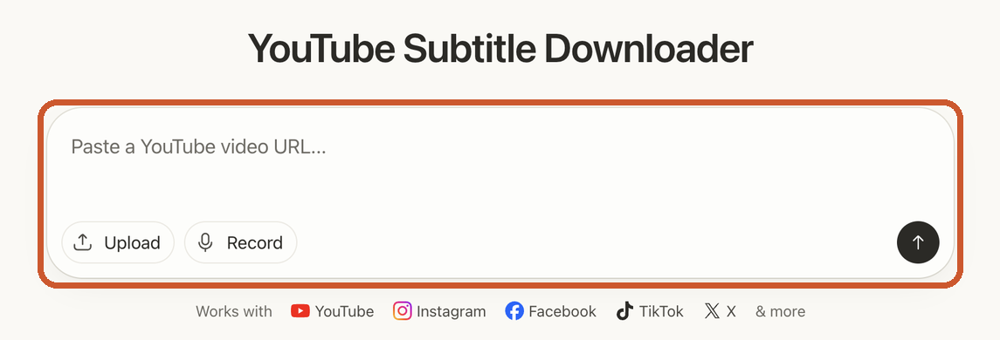
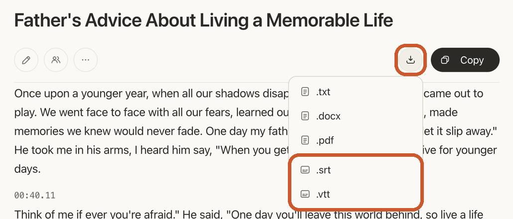
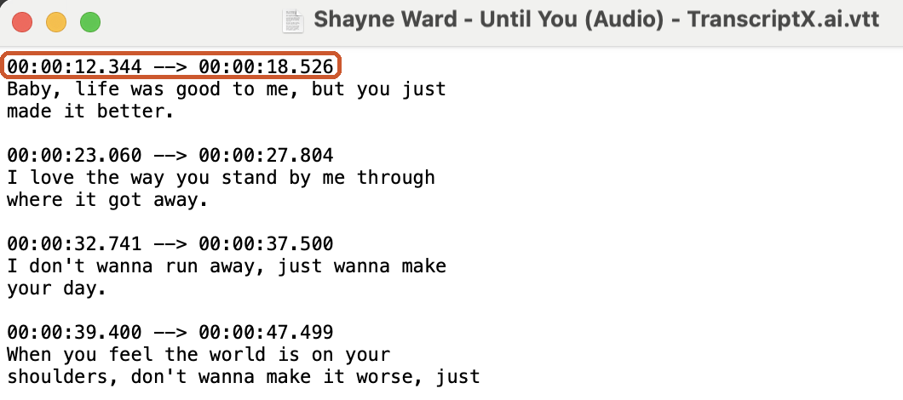

# DownSub Alternative: Get Subtitles Even When a Video Has None

> **Quick answer:** DownSub is a good free tool for downloading the subtitles a video already has. For videos with no captions or poor auto-captions, a better DownSub alternative is the [TranscriptX YouTube Subtitle Downloader](/youtube-subtitle-downloader/). It writes subtitles from the video's audio, lets you fix them, and downloads them as SRT or VTT.

DownSub is one of the most used subtitle downloaders on the web. You paste a link, pick a language and format, and save the file. For a lot of videos, that is all you need.

People start looking for a DownSub alternative when that simple flow stops working: the video has no subtitles to download, the auto-generated captions are full of mistakes, or the link comes from a site the tool doesn't handle well. This guide compares DownSub with TranscriptX, explains when each one is the right pick, and covers what to try if you were using SaveSubs too.

## DownSub vs TranscriptX at a Glance

DownSub downloads subtitles that already exist. TranscriptX writes new subtitles from the audio. That one difference decides most of the rows below.

| | DownSub | TranscriptX |
|---|---|---|
| How it gets subtitles | Downloads the subtitle tracks a video already has | Writes subtitles from the video's audio |
| Videos with no captions | Not covered on its site | Works: the speech is transcribed |
| Choose a subtitle language | Yes, from the tracks the video offers | Subtitles come in the spoken language (100+ languages detected) |
| Fix mistakes before saving | Not offered on its site | Yes, with **Edit** in the transcript |
| Download formats | SRT, VTT, TXT | SRT, VTT, TXT, DOCX, PDF |
| Links from | YouTube and about 40 other video sites | YouTube, TikTok, Instagram, Facebook, X and more |
| Your own files | Not offered on its site | Yes: upload a file or record in the browser |
| Account | Not stated on its site | Not required to try |
| Price | Free, with a Pro option | Free to try, with a [Pro plan](/pricing/) for heavy use |

DownSub details come from DownSub's own homepage, checked November 2026. TranscriptX details come from using the tool.

## Why People Look for a DownSub Alternative

Most people switch because the video has nothing to extract, or because what it has is wrong. DownSub describes itself as a tool to "extract subtitles" from a video. That works well when there is something to extract. These are the most common reasons it isn't enough:

- **The video has no subtitles.** Many videos, especially short clips, interviews and live streams, were uploaded without captions. A downloader that pulls existing tracks has nothing to give you.
- **The auto-captions are poor.** YouTube's automatic captions often miss names, technical terms and punctuation. Downloading them gives you the same mistakes in a file.
- **You need to fix the text first.** If the subtitles are going on your own video, you usually want to correct them before you export.
- **You need a document, not a subtitle file.** For notes, quotes or an article, a Word or PDF file is more useful than SRT.

## What to Look for in a DownSub Alternative

A good DownSub alternative should handle the cases DownSub can't, not just copy what it already does. Before you pick one, check these six points:

1. **Does it work on videos with no captions?** This is the main reason to switch. Only a tool that transcribes the audio can do it.
2. **Can you edit the subtitles before you download?** Fixing a name once in the editor is faster than fixing it in every line of an SRT file.
3. **Does it export the formats you need?** SRT and VTT for subtitles, plus TXT, DOCX or PDF if you also want a readable document.
4. **Does it take the links you use?** YouTube is a given. Check TikTok, Instagram, Facebook and X if you work with short videos.
5. **Can it handle your own files?** Recordings that never went online need an upload option.
6. **What does it cost to try?** Look for a free way to test it on your own video before you pay.

TranscriptX covers all six. DownSub covers formats and links well, but not the first two.

## How TranscriptX Works as a DownSub Alternative

TranscriptX doesn't depend on the captions a video already has. It listens to the audio and writes the subtitles itself, with a start and end time on every line.

1. Open the [YouTube Subtitle Downloader](/youtube-subtitle-downloader/) and paste the video link into the box that says *"Paste a YouTube video URL..."*.

2. Click the arrow (↑). TranscriptX detects the language and writes out what is said, with timestamps.
3. Read through it and use **Edit** to fix names or terms.
4. Click **Download**, the button next to **Copy**, and choose **.srt** or **.vtt** for subtitles, or **.txt**, **.docx** or **.pdf** for a document.

If you only need the text, **Copy** puts it on your clipboard instead. It is a separate button and does not save a file.

The same steps work for links from TikTok, Instagram, Facebook and X, and for files on your device. For a full walkthrough, see [how to download subtitles from YouTube](/blog/how-to-download-subtitles-from-youtube/).

## When DownSub Is Still the Better Choice

DownSub is still the quicker pick when a video already has good subtitles, and it is fair to say so:

- **Official translated subtitles.** If a video comes with subtitles in several languages, made by the creator or a translator, DownSub lets you pick the language track you want. TranscriptX writes subtitles in the language that is spoken.
- **Streaming and drama sites.** DownSub lists sites such as Viki, Viu and WeTV. If your video lives on one of those, it is the more direct option.
- **Captions made by people.** When a video already has good human-made subtitles, downloading them is the quickest way to get an accurate file.

A simple rule: if the video already has good subtitles, DownSub is fast. If it has none, or the ones it has are wrong, use TranscriptX.

## Looking for a SaveSubs Alternative Too?

The same answer applies: SaveSubs is another subtitle downloader that people often use alongside DownSub. If a video has no subtitles to save, or you want to correct them before you download, a tool that transcribes the audio, such as TranscriptX, fills that gap.

Before you switch, check which file you need:

- **A subtitle file to load into a video editor or re-upload:** SRT.
- **Captions for a web player:** VTT.
- **Text to read, quote or edit:** TXT, DOCX or PDF.

TranscriptX gives you all five from the same transcript. A VTT file looks like this: a start and end time for each line, followed by the words.

## Other Ways to Get Subtitles From a Video

You may not need a subtitle downloader at all. It depends on the job:

- **It is your own YouTube video?** YouTube Studio lets channel owners download their caption files. The steps are in [how to download subtitles from YouTube](/blog/how-to-download-subtitles-from-youtube/).
- **Just need the text?** The [YouTube Transcript](/youtube-transcript/) tool shows the transcript right in your browser.
- **Need a document?** [Download YouTube Transcript](/download-youtube-transcript/) saves it straight as TXT, DOCX or PDF.
- **Have the video file?** [Video to Text](/video-to-text/) transcribes uploads from your device, Google Drive, Dropbox or OneDrive.

## Frequently Asked Questions

### What is the best DownSub alternative?

It depends on the video. For videos with no captions or poor auto-captions, TranscriptX is a strong choice because it writes the subtitles from the audio. For videos that already have good subtitles in several languages, DownSub itself is often the quickest.

### Can I download subtitles from a YouTube video that has no captions?

Yes. Paste the link into the TranscriptX YouTube Subtitle Downloader. It transcribes the speech and lets you download the result as SRT or VTT.

### Is TranscriptX free like DownSub?

TranscriptX is free to try without an account. If you transcribe a lot, there is a Pro plan; see the [pricing page](/pricing/) for details.

### Can I edit the subtitles before downloading them?

Yes. Use **Edit** in the transcript to fix any word, then download the file.

### Does TranscriptX translate subtitles?

It writes subtitles in the language spoken in the video. To get another language, download the SRT and translate the lines; the timing stays the same.

### Which format should I choose, SRT or VTT?

Choose SRT for video editors and most platforms. Choose VTT for captions on a website.

## Try a DownSub Alternative That Writes the Subtitles for You

DownSub is great when the subtitles already exist. When they don't, or when they are wrong, you need a tool that listens to the video instead.

Paste your link into the [TranscriptX YouTube Subtitle Downloader](/youtube-subtitle-downloader/), check the text, and download SRT or VTT in a few clicks. Free to try, no account needed.
