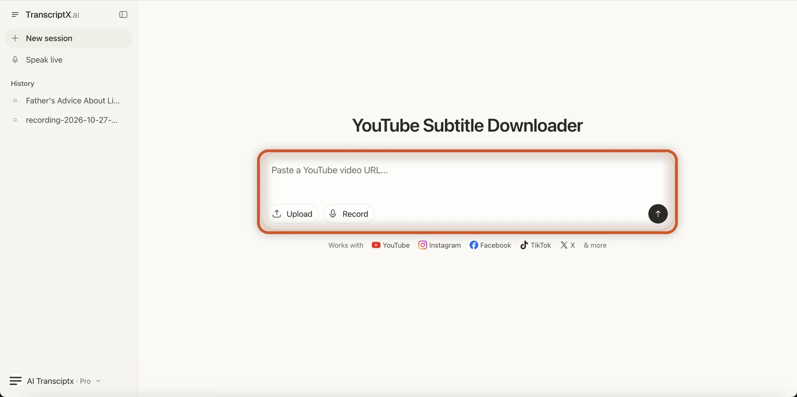
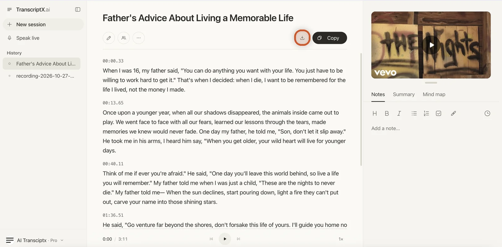
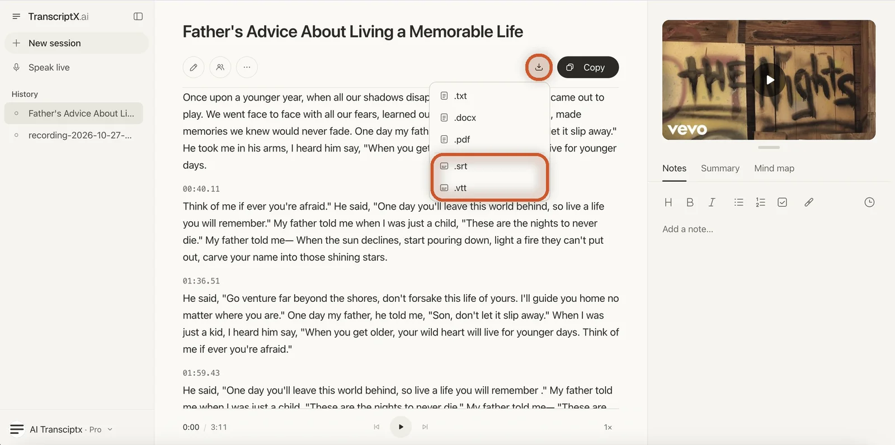
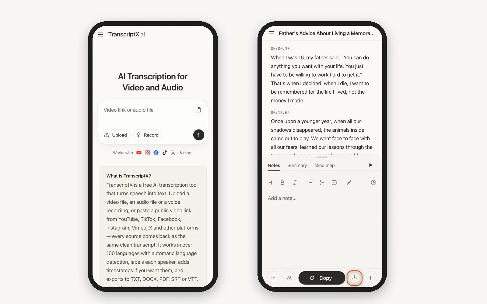
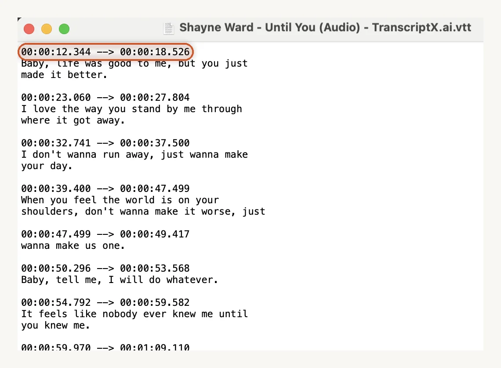

# How to Download Subtitles From YouTube

> **Quick answer:** YouTube has no download button for viewers, so how you download subtitles from YouTube depends on the video. If it is yours, open **YouTube Studio**, go to **Subtitles**, open the menu next to the language and click **Download**. For any public video, paste the link into [TranscriptX's YouTube Subtitle Downloader](/youtube-subtitle-downloader/), click **Download** and choose **.srt** or **.vtt**. It works even when the video has no captions.

You can watch subtitles on almost any YouTube video, but saving them as a file is another story. YouTube keeps them inside the player, so if you are wondering how to download subtitles from a YouTube video, the answer depends on whose video it is.

This guide covers each case: turning subtitles on while you watch, downloading them from your own channel, and getting an SRT or VTT file from any public video, including videos that have no captions at all.

## How to Get Subtitles on YouTube While You Watch

If you only want to read along, you do not need to download anything. Here is how to see subtitles on YouTube.

**On a computer:**

1. **Open the video** on youtube.com.
2. **Click the CC button** at the bottom right of the player. You can also press **C** on your keyboard.
3. To pick a language, click the **Settings** gear, then **Subtitles/CC**, and choose one from the list.

**On a phone (YouTube app):**

1. **Tap the video** to show the player controls.
2. **Tap the CC icon** at the top of the player.
3. If you do not see it, tap the **Settings** gear and open **Captions**.

When the CC button is greyed out or missing, the video has no captions. Skip to [what to do when a video has no subtitles](#what-to-do-when-a-youtube-video-has-no-subtitles).

### How to get English subtitles on YouTube

If the video has captions in another language, YouTube can translate them for you:

1. Click the **Settings** gear and open **Subtitles/CC**.
2. Choose **Auto-translate**.
3. Select **English**.

Auto-translated subtitles are machine translations, so names and technical terms can come out wrong. They are fine for following along, less so for quoting.

## Can You Download Subtitles From YouTube?

Yes, but not from the player. Viewers do not get a download button for captions, so how to download captions from YouTube comes down to two routes:

- **It is your video.** YouTube Studio lets channel owners download their own caption files.
- **It is someone else's public video.** You need a tool that gives you the subtitles as a file. TranscriptX does this from the video link.

The two routes give you different things. YouTube Studio hands you the captions that already exist on the video. TranscriptX listens to the audio and writes new, timed subtitles, so the wording may differ slightly from the creator's captions. That is also why it works on videos with no captions.

## How to Download YouTube Video Subtitles From Your Own Channel

If you uploaded the video, YouTube Studio is the most direct way to get its subtitle file:

1. Open **YouTube Studio** and click **Subtitles** in the left menu.
2. **Click the video** you want.
3. Find the language row, open the **three-dot menu** next to it and choose **Download**.
4. **Pick a format**, such as **.srt** or **.vtt**, and save the file.

This only works for videos on a channel you manage. For anyone else's video, use the method below.

## How to Download Subtitles From YouTube With TranscriptX

TranscriptX works with any public YouTube link and does not need captions on the video. It is the quickest way to download subtitles for YouTube videos you did not upload.

1. **Copy the video link.** On YouTube, click **Share** under the video, then **Copy link**. You can also copy it from the address bar.
2. **Open the [YouTube Subtitle Downloader](/youtube-subtitle-downloader/)** and paste the link into the box that says **"Paste a YouTube video URL..."**.
3. **Click the arrow button** to start. In our test, a 4-minute video was done in about 6 seconds.

4. **Check the transcript.** It opens on its own page, split into paragraphs with timestamps, with the video next to it so you can play it while you read. If a word is wrong, click the **pencil** icon to fix it before you export.

5. **Click Download.** It is the button next to **Copy**. A menu opens with the file types.
6. **Choose .srt or .vtt** to save the subtitles as a timed caption file.

The same menu also has **.txt**, **.docx** and **.pdf** if you want the words as a document rather than a subtitle file. And if you only need the text in your clipboard, the **Copy** button copies the whole transcript, timestamps included, without downloading anything.

You do not need an account. The same steps work in your phone's browser: on a small screen, **Copy** and **Download** sit in the bar at the bottom of the transcript.

## SRT vs VTT: Which Subtitle File Should You Download?

Both are plain-text caption files with a line of text and the time it should appear. The difference is where you plan to use them.

| | SRT (.srt) | VTT (.vtt) |
|---|---|---|
| Best for | Video players and editors | Web video players |
| Works with | VLC, most video editors, YouTube upload | HTML5 video on websites, YouTube upload |
| Styling | Plain text | Supports basic styling and positioning |
| Pick it when | You are not sure which one you need | Your website player asks for WebVTT |

If in doubt, download **.srt**. It is the most widely supported subtitle format.

## How to Download a YouTube Video With Subtitles

Many people searching for this want one video file with the subtitles included. TranscriptX does not download videos. It gives you the subtitle file, which you can pair with a video you are allowed to keep.

- **Your own video:** in YouTube Studio, open **Content**, find the video, open its **three-dot menu** and choose **Download**. Then get the subtitles as shown above.
- **Watching with subtitles offline:** put the video and the **.srt** file in the same folder with the same name, for example `talk.mp4` and `talk.srt`. Players such as VLC load the subtitles automatically. You can also add the file from the player's subtitle menu.

Downloading other people's videos is limited by YouTube's terms, so only save videos you own or have permission to use.

## How to Add Subtitles to Your YouTube Video

The SRT file also works in the other direction. If your own video has no captions, or the automatic ones are poor, you can upload a clean file:

1. Paste your video link into TranscriptX and download the subtitles as **.srt**.
2. Open the file, or use the **pencil** icon in TranscriptX first, to fix any names or terms.
3. In **YouTube Studio**, open **Subtitles**, choose the video and the language, and click **Add**.
4. Choose **Upload file**, select **With timing**, and pick your **.srt** file.
5. Review the captions and click **Publish**.

## What to Do When a YouTube Video Has No Subtitles

Sometimes the CC button is missing and there is nothing to download. That usually happens when:

- **The creator did not add captions**, and YouTube did not generate them automatically.
- **The language is not supported** by YouTube's automatic captions.
- **The audio is hard to process**, such as loud music or several people talking at once.
- **The video is new**, and automatic captions are not ready yet.

YouTube Studio cannot help here, and neither can tools that only copy YouTube's existing captions. TranscriptX works from the audio, so [pasting the link into TranscriptX](/youtube-subtitle-downloader/) still gives you an SRT or VTT file. It handles over 100 languages and detects the language automatically.

## YouTube Studio vs TranscriptX: Which One to Use

| | YouTube Studio | TranscriptX |
|---|---|---|
| Whose videos | Only your own | Any public video |
| Needs captions on the video | Yes | No, it transcribes the audio |
| Subtitle files | .srt, .vtt and more | .srt, .vtt |
| Text files | No | .txt, .docx, .pdf |
| Edit before export | In the Studio caption editor | Yes, with the pencil icon |
| Account needed | Yes, your channel | No |

**Our advice:** use YouTube Studio when you need the exact captions from your own channel. Use TranscriptX for anyone else's video, for videos with no captions, or when you also want the text as a document.

## Frequently Asked Questions

### Can I download auto-generated subtitles from YouTube?

From your own channel, yes. YouTube Studio lists the automatic captions next to the language, and you can download them like any other track. For other people's videos, TranscriptX creates its own subtitles from the audio, so you get a file whether or not YouTube generated captions.

### How do I download closed captions from YouTube?

Closed captions and subtitles are the same files on YouTube, marked **CC** in the player. Download them from YouTube Studio if the video is yours, or paste the link into [TranscriptX](/youtube-subtitle-downloader/) and choose **.srt** or **.vtt** from the **Download** menu.

### How do I copy subtitles from YouTube?

Open the video's transcript on YouTube and select the text, or paste the link into TranscriptX and click **Copy**. That copies the whole transcript, timestamps included, so you can paste it into any document.

### Is downloading a YouTube transcript different from downloading subtitles?

Slightly. A subtitle file (.srt or .vtt) is timed for a video player. A transcript is the same words as readable text. Our guide on [how to get a transcript of a YouTube video](/blog/how-to-get-youtube-transcript/) covers that side, or you can use [Download YouTube Transcript](/download-youtube-transcript/) to save it as TXT, DOCX or PDF.

### Can I get English subtitles for a video in another language?

On YouTube, use **Settings**, **Subtitles/CC**, **Auto-translate**, **English**, as long as the video has captions to translate. TranscriptX writes the subtitles in the language spoken in the video.

### Is it free?

Yes. Downloading your own captions in YouTube Studio is free, and so is TranscriptX. You can use it without an account.

## Download Your YouTube Subtitles Now

For your own videos, YouTube Studio gives you the original caption file. For everything else, including videos with no captions, [paste the link into TranscriptX](/youtube-subtitle-downloader/), click **Download** and save an **.srt** or **.vtt** file in seconds.

Need the words rather than a caption file? See [how to get a transcript of a YouTube video](/blog/how-to-get-youtube-transcript/).
