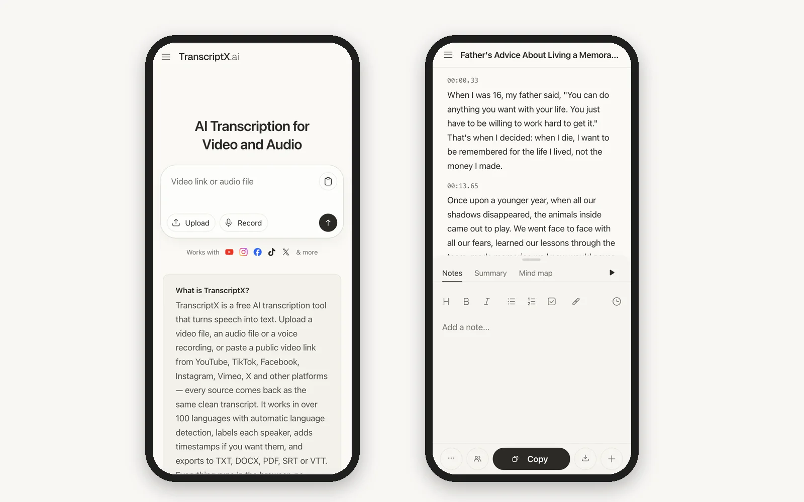
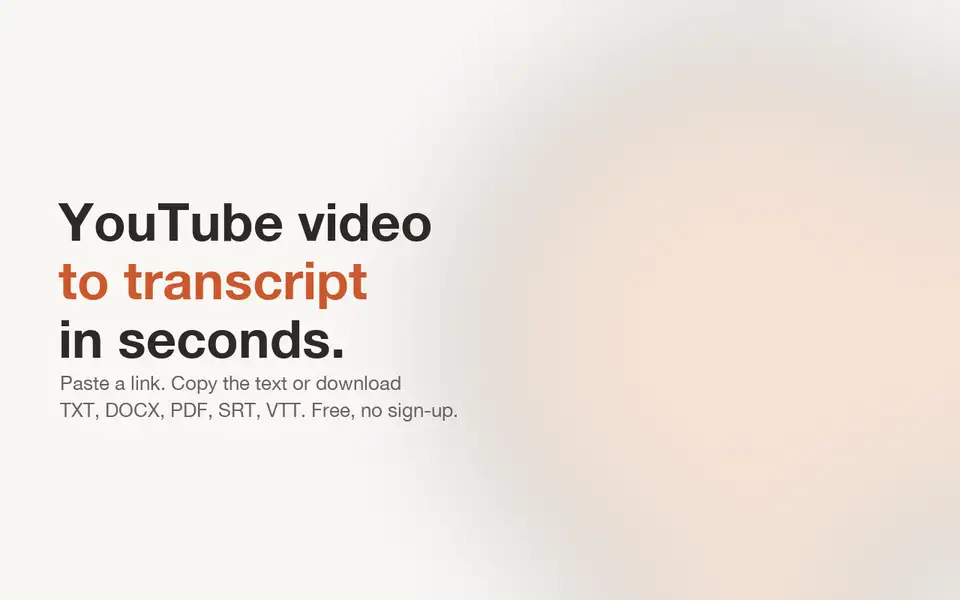
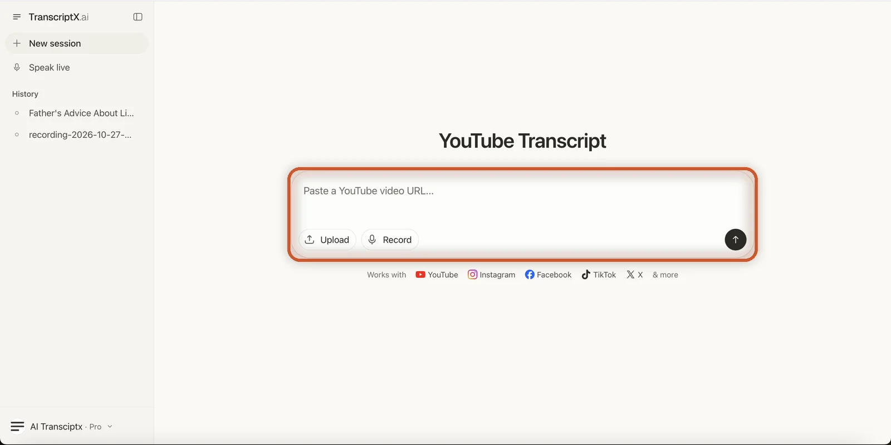
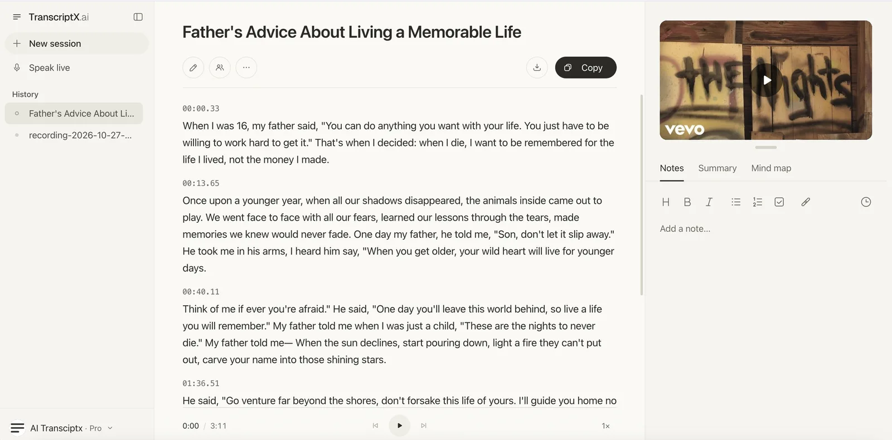
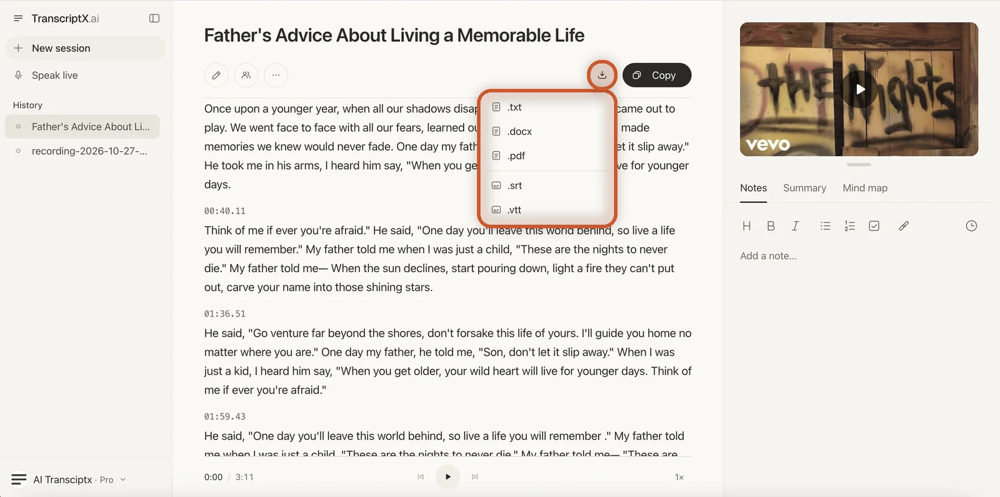

# How to Get a Transcript of a YouTube Video

> **Quick answer:** On a computer, open the video, click **...more** under the title, scroll to the end of the description and click **Show transcript**. The transcript opens next to the video. In the YouTube app, tap the description and then **Show transcript**. If the video has no transcript, or you need the text as a file, paste the link into [TranscriptX's YouTube Transcript tool](/youtube-transcript/) and it writes one from the audio.

Most YouTube videos already have a transcript. It is hidden behind a couple of clicks, it is awkward to copy out, and some videos do not have one at all.

This guide covers each way to get the transcript of a YouTube video: on desktop, on your phone, as the channel owner in YouTube Studio, and with TranscriptX when YouTube has nothing to show or you need the full text in a document. The TranscriptX method comes with screenshots and a short video, so you can follow along.

## How to Get the Transcript of a YouTube Video on Desktop

This is the fastest way if the video already has captions. It works in any desktop browser.

1. **Open the video** on youtube.com.
2. **Click "...more"** in the description box under the video title to expand it.
3. **Scroll to the end of the description.** You will see a **Transcript** section.
4. **Click "Show transcript".** The transcript panel opens on the right side of the video.

Each line in the panel has a timestamp. Click a line and the video jumps to that moment, which helps when you are looking for one quote in a long talk.

If the video has captions in more than one language, a menu at the bottom of the panel lets you switch between them.

**Can't find the button?** **Show transcript** only appears when the video has captions, either added by the creator or generated automatically by YouTube. If it is missing, go to [what to do when a video has no transcript](#what-to-do-when-a-youtube-video-has-no-transcript).

## How to See the Transcript on YouTube on Your Phone

The YouTube app on iPhone and Android can show the transcript too:

1. **Open the video** in the YouTube app.
2. **Tap the title or description** below the video to open the full description.
3. **Scroll down** to the **Transcript** section.
4. **Tap "Show transcript".**

The transcript scrolls along with the video, and you can tap a line to jump to it.

The catch is copying. The app is made for reading the transcript, not for selecting the text. If you need the words in a document, use a computer, or open TranscriptX in your phone's browser and paste the link there. It has a **Copy** button for the whole transcript.

> 📝 **Chú thích:** Ảnh ghép 2 điện thoại. Trái: trang chủ TranscriptX trên mobile (ô "Video link or audio file"). Phải: trang kết quả transcript có nút **Copy** ở thanh dưới. Nguồn: `_source/mobile/mobile-homepage.png` + `mobile-transcript-result.png`.

## How to Copy a Transcript From YouTube

With the transcript panel open on desktop:

1. **Hide the timestamps** (optional). Click the three-dot menu at the top of the transcript panel and choose **Toggle timestamps**, so you copy only the words.
2. **Select the text.** Click at the start of the first line and drag down to the last line.
3. **Copy and paste** it into Google Docs, Word or any text editor with Ctrl + C and Ctrl + V (Cmd + C and Cmd + V on a Mac).

This is fine for a short video. For a long one, a few things get in the way:

- **Dragging to select** an hour of text inside a small panel is slow and easy to get wrong.
- **Auto-generated captions** often have little punctuation and no paragraph breaks, so the pasted text is one long block.
- **Speakers are not labelled**, so in an interview or podcast you cannot tell who said what.

If any of these is a problem, the TranscriptX method below gives you the whole text in one click.

## How to Get a YouTube Transcript With TranscriptX

TranscriptX does not depend on YouTube's captions. It listens to the audio of the video and writes the transcript itself, so it also works on videos with no **Show transcript** button.

> 📝 **Chú thích:** Video động ~26 giây, cùng 1 video mẫu (Shayne Ward) từ đầu đến cuối, có con trỏ chuột bấm và thanh tiến trình 5 bước: mở đầu "YouTube video to transcript in seconds" → ① YouTube Share → Copy link → ② dán link vào trang YouTube Transcript, bấm mũi tên → ③ đang xử lý (~6 giây cho video 4 phút) → transcript hiện ra → ④ bấm **Copy**: chép toàn bộ nội dung → ⑤ bấm nút **Download** cạnh Copy: mở menu .txt .docx .pdf .srt .vtt → cảnh điện thoại → kêu gọi hành động. Video, thumbnail, title và mô tả để đăng YouTube nằm trong `images/video/`.

1. **Copy the video link.** Click **Share** under the video, then **Copy link**. You can also copy it from your browser's address bar.
2. **Open TranscriptX's [YouTube Transcript](/youtube-transcript/) page** and paste the link into the box that says **"Paste a YouTube video URL..."**.
3. **Click the arrow button** on the right of the box to start.

> 📝 **Chú thích:** Trang YouTube Transcript của TranscriptX, khoanh cam ô "Paste a YouTube video URL..." (bước 2–3). Nguồn: `_source/youtube-transcript/youtube-transcript-tool.png`.

When the transcript is ready, it opens on its own page:

- **A title** based on what the video is about.
- **The text split into paragraphs**, each starting with a timestamp such as `00:13.65`.
- **The video itself** in the panel on the right, so you can play it while you read.
- **A player** at the bottom with skip buttons and a playback speed setting.
- **A Notes tab** next to the video, where you can write your own notes on the transcript.

> 📝 **Chú thích:** Trang kết quả transcript: tiêu đề, các đoạn có timestamp, nút ✏️/👥/⋯, ⬇ download và **Copy**, video bên phải, tab Notes. Nguồn: `_source/transcript/transcript-result-light.png`.

From there you can:

- Click **Copy** to copy the whole transcript at once, timestamps included.
- Turn **timestamps** on or off, depending on whether you want the time codes in your text.
- Click the **download** icon next to it to save the transcript as a file.
- Click the **pencil** icon to fix a word the AI got wrong before you copy or export.

In our test, a 4-minute YouTube video was transcribed in about 6 seconds. You do not need an account to use it. Signing in keeps your transcripts in the **History** list on the left, on every device you use.

## How to Download a Transcript From YouTube

YouTube has no download button for viewers. There are three ways around that, depending on whose video it is.

### If you are watching someone else's video

Copy the transcript as shown above, paste it into a document and save it. It works, but it is manual, and you lose the timestamps unless you copy them too.

### If it is your own video: YouTube Studio

Channel owners can download caption files directly:

1. Open **YouTube Studio** and go to **Subtitles** in the left menu.
2. Click the video you want.
3. Next to the language, open the three-dot menu and choose **Download**.
4. Pick a format such as **.srt** or **.vtt**.

### For any public video: TranscriptX

Paste the link into TranscriptX as in the steps above. When the transcript is ready, click the **download** icon at the top of the transcript and pick a format: **.txt**, **.docx**, **.pdf**, **.srt** or **.vtt**, with or without timestamps. TXT and DOCX suit reading and editing. SRT and VTT are subtitle files you can load into a video editor. For a page that focuses only on exporting, see [Download YouTube Transcript](/download-youtube-transcript/).

> 📝 **Chú thích:** Menu Download đang mở, khoanh cam nút ⬇ và 5 định dạng .txt .docx .pdf .srt .vtt. Nguồn: `_source/transcript/transcript-download-menu-open.png`.

## What to Do When a YouTube Video Has No Transcript

Sometimes the **Show transcript** button is simply not there. That usually means YouTube has no captions for the video, for one of these reasons:

- **The creator did not add captions**, and YouTube did not generate them automatically.
- **The language is not supported** by YouTube's automatic captions.
- **The audio is hard to process**, for example loud music, heavy background noise or several people talking at once.
- **The video was uploaded recently**, and automatic captions are not ready yet.
- **The creator removed** the captions.

In most of these cases, waiting will not help. Since TranscriptX works from the audio rather than from YouTube's captions, you can [paste the link into TranscriptX](/youtube-transcript/) and get a transcript anyway, following the same three steps as above.

## How to Get the Script of a YouTube Video

When people search for the "script" of a YouTube video, they usually mean the words spoken in it. That is exactly what the transcript is, so any method above gets you the script.

The creator's original script, with notes and directions, is a different thing. It only exists if the creator chooses to share it, often in the description, on their website or on Patreon.

To turn a transcript into a clean, readable script:

- **Remove the timestamps** so only the spoken words remain.
- **Split it into paragraphs** at each change of topic or speaker.
- **Cut filler words** such as "um", "you know" and repeated starts.
- **Add speaker names** if more than one person talks.

TranscriptX handles most of this: you can turn the timestamps off, the text is already split into paragraphs, and the **pencil** icon lets you tidy up the wording before you copy or download it.

## YouTube's Transcript vs TranscriptX: Which One to Use

Both are free to start. They are good at different things.

| | YouTube's built-in transcript | TranscriptX |
|---|---|---|
| Needs captions on the video | Yes | No, it transcribes the audio |
| Punctuation and paragraphs | Often missing in auto captions | Yes |
| Copy the whole text | Drag to select | One **Copy** button |
| Copy on a phone | Hard in the app | Yes, in the browser |
| Download as a file | Only your own videos (YouTube Studio) | TXT, DOCX, PDF, SRT, VTT |
| Timestamps | On or off | On or off |
| Edit the text | No | Yes, with the pencil icon |
| Speaker labels | No | On the Pro plan |
| Install needed | No | No, works in the browser |

**Our advice:** if the video has a transcript and you only need to skim it or find one quote, YouTube's own panel is enough. Use TranscriptX when the video has no transcript, when you need the full text in a document, or when you want to download it as a file.

## Frequently Asked Questions

### Why can't I see "Show transcript" on YouTube?

The button only appears when the video has captions. If the creator did not add any and YouTube did not create automatic captions, there is no transcript to show. You can still get one by pasting the video link into [TranscriptX](/youtube-transcript/), which transcribes the audio directly.

### Can I get a transcript of a YouTube video for free?

Yes. YouTube's built-in transcript is free whenever the video has captions. TranscriptX is free to use too, and you do not need an account. Paste the link and the transcript is ready in seconds.

### Can I get the transcript of someone else's YouTube video?

Yes, for any public video. **Show transcript** works on any video that has captions, and TranscriptX works with any public YouTube link. Private videos cannot be opened from a link, so they cannot be transcribed this way.

### How do I get a YouTube transcript without timestamps?

On desktop, open the transcript panel, click the three-dot menu and choose **Toggle timestamps**, then copy the text. In TranscriptX, turn timestamps off before you copy or download the transcript.

### Can I see the transcript on the YouTube app?

Yes. Tap the video description, scroll down and tap **Show transcript**. Copying the text is easier on a computer or in TranscriptX.

### Does TranscriptX work with other sites besides YouTube?

Yes. TranscriptX also works with links from Instagram, Facebook, TikTok and X, and the **Upload** button takes files from your device, Google Drive, Dropbox or OneDrive.

## Get Your Transcript Now

For a video that already has captions, YouTube's **Show transcript** button is the quickest route. For everything else, such as videos without captions, transcripts you want to download, or long talks you need as clean text, [paste the link into TranscriptX](/youtube-transcript/) and get the full transcript, ready to copy or download.

Want to do more with the same video? You can [download the subtitles as SRT](/youtube-subtitle-downloader/) or [get a short summary of the video](/youtube-video-summarizer/).
