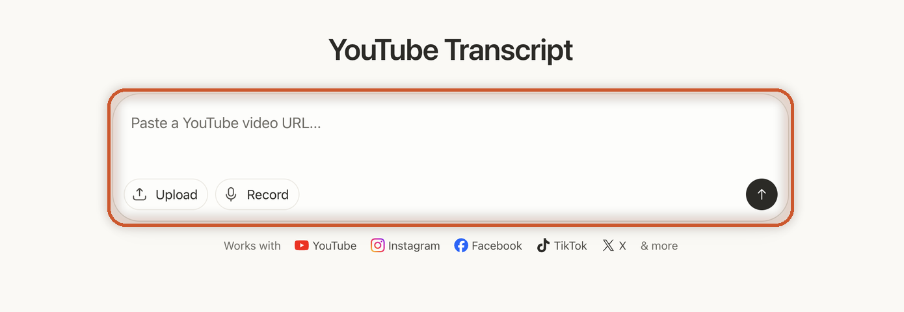
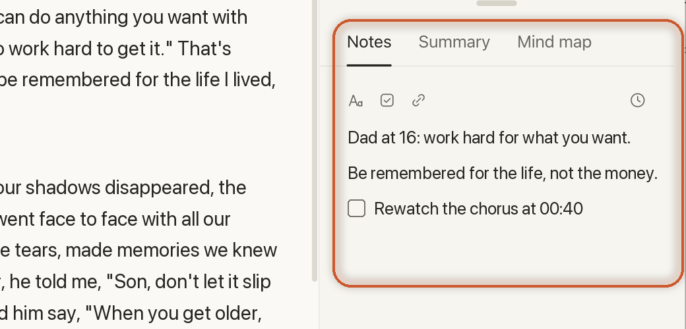
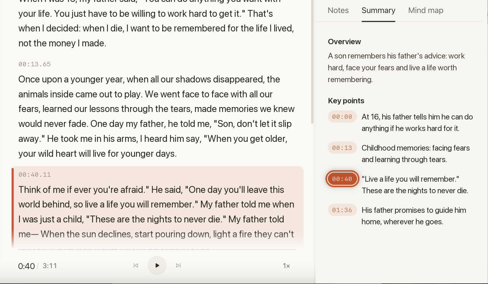
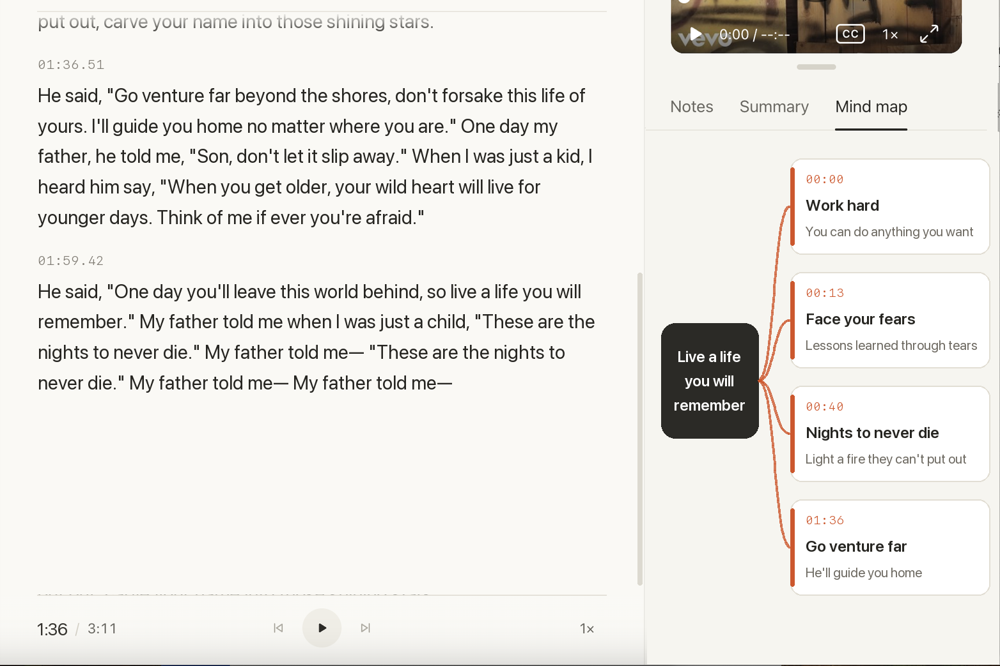
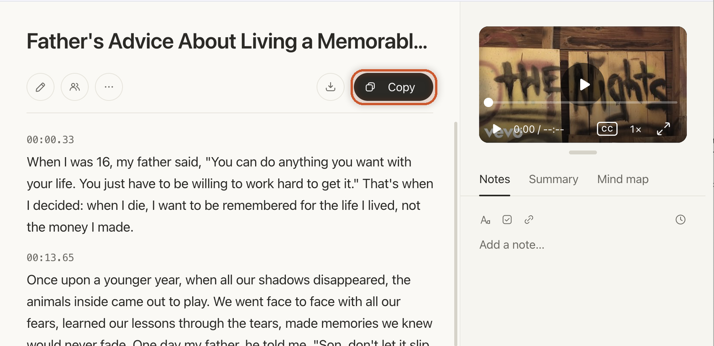
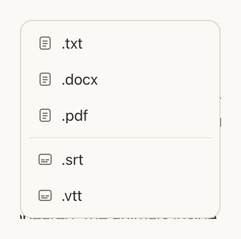

# How to Summarize a YouTube Video: Notes, Summary and Mind Map

> **Quick answer:** To summarize a YouTube video, paste its link into [TranscriptX](/youtube-transcript/) to get a timestamped transcript, then write the key points in the **Notes** tab next to it. Soon, the **Summary** tab will list the key points for you, each with a timestamp you can click to jump to that part of the transcript, and **Mind map** will show the whole video at a glance.

A 40-minute lecture often comes down to five ideas. A one-hour meeting recording often comes down to three decisions and a few tasks. If you want to know how to summarize a YouTube video without watching all of it again, the trick is to work from the transcript, not the video.

TranscriptX puts everything you need for that on one screen: the transcript, the video, and three tabs beside them, **Notes**, **Summary** and **Mind map**. This guide shows how to summarize YouTube videos with each one. Notes works today. Summary and Mind map are coming soon, and you'll see a preview of how they work.

## Why a good summary starts with the transcript

A summary of a video is built from what was said in it. Even an AI summary of a YouTube video works from the words, not the pictures. So the quality of the summary depends on the transcript behind it.

A transcript with timestamps gives you two things:

- **The whole video, not just the title.** The summary reflects everything that was said, from the first minute to the last.
- **A way to check.** When a key point looks surprising, you can jump to its timestamp and hear it for yourself.

TranscriptX gives you that transcript from a YouTube link in seconds. It's free to use every day, and you don't need an account to try it.

## Step 1: Get the transcript of the YouTube video

1. Copy the link of the YouTube video.
2. Open the [YouTube Transcript](/youtube-transcript/) page on TranscriptX and paste the link into **Paste a YouTube video URL...**.
3. Click the arrow button.

In a few seconds the transcript appears. It's split into short paragraphs, each with a timestamp, and the video plays right next to it, so you can listen to any part you're not sure about. For a full walkthrough, see [how to get the transcript of a YouTube video](/blog/how-to-get-youtube-transcript/).

On the right of the transcript you'll see three tabs: **Notes**, **Summary** and **Mind map**. The next steps go through each one.

## Step 2: Write your own summary in Notes

The **Notes** tab is the simplest way to summarize a video, and it works today. Read the transcript, and as you find a point worth keeping, write it in **Add a note...**.

A few things make Notes handy for summaries:

- **It sits next to the full text.** You never lose track of where a point came from.
- **Formatting, checklists and links.** Turn notes into a short list of key points, or a to-do list after a meeting.
- **Timestamps in your notes.** Mark the moment a point was made, so you can come back to it later.

Writing the summary yourself takes a few minutes, but it's one of the best ways to remember what you watched. That's why it works so well for lectures you'll be tested on.

## Step 3: Get the key points with Summary (coming soon)

The **Summary** tab is coming soon to TranscriptX. Right now it shows "Coming soon: The key points of this transcript, summarized automatically." Pro users will get the beta first.

It turns TranscriptX into a YouTube transcript summarizer, right next to the full text. Here's how it's designed to work, shown in a preview:

- **The key points of the video, written for you.** You read the gist of a long video in under a minute.
- **A timestamp next to each point.** Every point shows the moment in the video it comes from.
- **Click a timestamp to jump there.** The transcript scrolls to that paragraph and highlights it, so you can read the exact words behind the point.

That last part matters. A summary is only useful if you can trust it, and a timestamp lets you check any point in seconds. Summary is made for long recordings such as lectures and meetings, where you want the main points first and the details only when you need them.

## Step 4: See the whole video at a glance with Mind map (coming soon)

The **Mind map** tab is also coming soon. It will show "a map of this transcript's ideas: the whole talk at a glance." Instead of reading a list, you see a tree: the main idea, and the topics that branch from it.

A mind map helps when the structure of a video matters as much as its points: a course module, a long interview, or a talk that builds an argument step by step. Pro users will get the Mind map beta first, along with Summary.

## Copy or download the transcript

Whichever way you summarize, the full transcript stays with you:

- Click **Copy** to copy the whole transcript, timestamps included, and paste it into your own document.
- Click **Download**, the separate button next to **Copy**, to save it as .txt, .docx, .pdf, .srt or .vtt.

A .docx or .pdf is handy for study notes or a meeting record. Timestamps can be turned off when you only want plain text.

## When a YouTube video summary helps most

**Lectures and online courses.** Write the key points in Notes as you go, and keep the timestamps so you can rewatch the hard parts before an exam. Summary will give you the main ideas of a long lecture first, and Mind map will show how the topics fit together.

**Recorded meetings and webinars.** Note the decisions and tasks with a checklist in Notes. Summary is built for exactly this kind of long recording, where most of the hour is discussion and only a few points matter.

**Podcasts and interviews.** Mark the quotes worth keeping with their timestamps, so you can find and check them later.

**Long tutorials.** Turn a 30-minute tutorial into a short list of steps in Notes, with a timestamp for each one.

## Notes, Summary or Mind map: which one do you need?

| If you want to… | Use | Available |
|---|---|---|
| Read every word, with timestamps | **Transcript** | Now, free every day |
| Keep the points that matter to you, in your own words | **Notes** | Now |
| Get the key points written for you, with timestamps to check them | **Summary** | Coming soon, Pro beta first |
| See how the ideas in the video connect | **Mind map** | Coming soon, Pro beta first |
| Keep the full text in a document or subtitle file | **Copy** or **Download** | Now |

## Frequently Asked Questions

### How do I get a summary of a YouTube video for free?

Paste the link into the [YouTube Transcript](/youtube-transcript/) page to get the transcript free, then write the key points in the **Notes** tab next to it. TranscriptX is free to use every day, and you can try it without an account.

### Does TranscriptX summarize YouTube videos automatically?

Not yet. The **Summary** tab is coming soon and will summarize the key points of a transcript automatically, each with a timestamp. Pro users will get the beta first. Today you can write your own summary in **Notes**.

### What does the timestamp next to each key point do?

It shows where in the video the point comes from. Click it and the transcript jumps to that paragraph and highlights it, so you can read or hear the exact words before you rely on the point.

### Can I turn a YouTube video into a mind map?

The **Mind map** tab is coming soon to TranscriptX. It will show the main idea of the video and the topics that branch from it, so you can see the whole talk at a glance.

### Can I summarize a long lecture or a recorded meeting?

Yes. Long recordings are where a summary helps most. Get the transcript first, then write the key points in Notes. If the recording is a file rather than a YouTube link, upload it to [TranscriptX](/) instead of pasting a link.

### What's the difference between a transcript, notes and a summary?

A transcript is every word that was said, with timestamps. Notes are the points you choose to keep, in your own words. A summary is the main points written for you. TranscriptX puts all three side by side, so you can move between them.

## Summarize your next YouTube video

Paste a YouTube link into TranscriptX, read the timestamped transcript and write the key points in Notes. Summary and Mind map are on the way to give you the key points and the big picture in one click. It's free every day, with no account needed to start.

[Get a YouTube transcript free](/youtube-transcript/)
