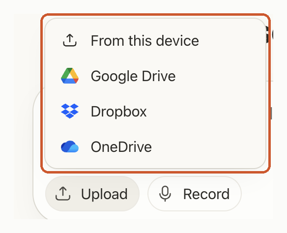
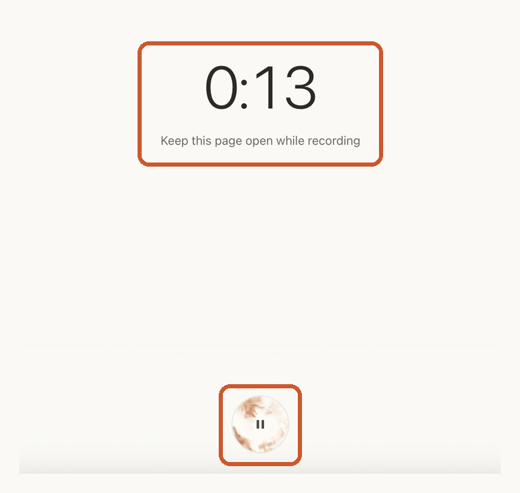
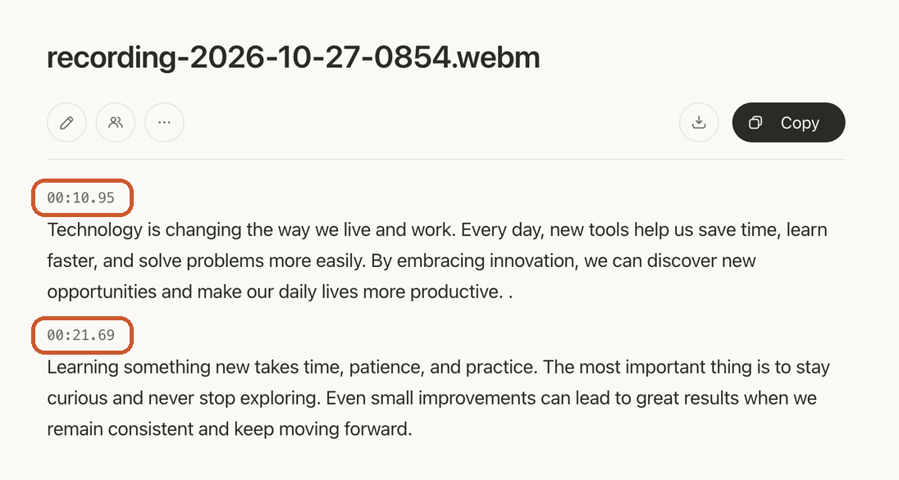
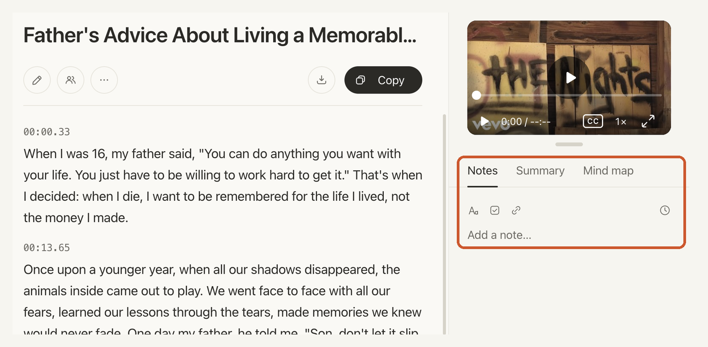
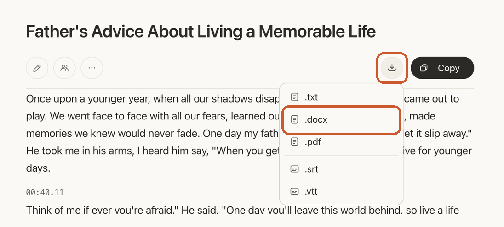

# How to Transcribe an Interview for Qualitative Research

> **Quick answer:** Here is how to transcribe interviews for qualitative research: record clearly, upload the file to [TranscriptX Interview Transcription](/interview-transcription/) and get a timestamped draft in seconds. Then check it against the audio, label the speakers, remove names that could identify participants and export it as a Word file for coding.

Transcribing interviews is the slowest part of most qualitative research projects. Typing up a single hour of audio by hand usually takes four to six hours, and a study with 20 participants can eat weeks of your time before analysis even starts.

This guide shows how to transcribe an interview for qualitative research step by step: what to prepare, how to get a first draft with AI, how to check and format it, and how to handle focus groups and anonymisation. It works the same for a thesis, a journal article or a UX research study.

## What Does Transcribing an Interview Involve?

Transcribing an interview means turning the recorded conversation into written text you can read, code and quote. In qualitative research, the transcript is your data: themes, codes and quotes all come from it, so it has to be complete and traceable to the recording.

A research transcript usually has four parts:

- **A header:** study name, participant ID, date and interviewer.
- **The conversation:** what each person said, in order.
- **Speaker labels:** who said each line, such as "Interviewer" and "P04".
- **Timestamps:** where each passage sits in the recording, so you can go back and listen.

Getting the words down is only the first half. The second half is checking them, which is where your time is best spent.

## Before You Start: What You Need

A little preparation saves hours of correcting later.

1. **Consent to record.** Make sure participants agreed to be recorded and transcribed, in line with your ethics approval or company rules.
2. **A clear recording.** Put the phone or recorder close to both speakers, in a quiet room. Background noise and people talking over each other cause more errors than accents do.
3. **A transcription style.** Decide whether you need every "um", pause and false start (verbatim), or readable sentences (clean or intelligent verbatim). Most thematic analysis works fine with clean text; discourse or conversation analysis usually needs verbatim.
4. **A naming system.** Give each participant an ID (P01, P02…) before you start, and use it in file names and speaker labels.

## How to Transcribe an Interview Step by Step

Here is the full workflow with TranscriptX. The same steps work for one interview or a whole study.

### Step 1: Upload or record the interview

Open [Interview Transcription](/interview-transcription/) and click **Upload**. Choose where the file is: **From this device**, **Google Drive**, **Dropbox** or **OneDrive**. Audio and video files both work, so a Zoom, Teams or phone recording can go straight in.

If you are interviewing someone in person, you can click **Record** instead and capture the conversation in the browser. Keep the page open while you record.

### Step 2: Get the draft transcript

TranscriptX detects the language and writes out the conversation as paragraphs, each with a timestamp. A few minutes of audio usually comes back in seconds, and longer interviews take a little more.

### Step 3: Label the speakers

You need to know who said what before you can code or quote anything. On the Pro plan, TranscriptX labels speakers automatically (**Speakers** in the toolbar). Before you export, make sure each label matches your participant IDs. On the Free plan, you get timestamped paragraphs without speaker names, which is fine for one-to-one interviews where the turns are easy to follow.

### Step 4: Check the transcript against the audio

Play the recording and read along. Use **Edit** to fix names, technical terms and anything that was hard to hear. Pay most attention to:

- names, places, numbers and dates;
- passages where people spoke over each other;
- short answers like "yes" or "no", which can drop out when said quietly;
- anything you plan to quote.

While you read, add first impressions or possible codes in the **Notes** tab next to the transcript. You can add a timestamp to a note, so you know which moment it refers to.

### Step 5: Export for analysis

Click **Download** and choose **.docx** to open the transcript in Word or import it into your analysis software. **.pdf** works for archiving and **.txt** for plain text. If you only need a passage, **Copy** puts the text, with timestamps, on your clipboard instead.

## Verbatim or Clean: Which Transcription Style Do You Need?

The right style depends on what you will analyse.

| Style | What it keeps | Best for |
|---|---|---|
| Full verbatim | Every word, filler ("um", "you know"), false starts, pauses, laughter | Discourse and conversation analysis, linguistics |
| Clean verbatim | The meaning in full sentences, without fillers and stutters | Thematic analysis, most interview studies, quotes in papers |
| Edited | Shortened, grammatically corrected text | Reports and articles, not usually research data |

Whichever you pick, write it down in your methods section and use it for every transcript in the study. If you need full verbatim, add pauses and non-verbal notes (for example `[laughs]` or `[pause 3s]`) during your review in Step 4.

## How to Transcribe Qualitative Interviews for Analysis

Once the words are right, a few formatting habits make coding much easier.

- **Start each file with a header.** Participant ID, date, interviewer, duration and transcription style.
- **Start a new paragraph each time the speaker changes**, labelled with the speaker ID.
- **Keep the timestamps.** They let you and your supervisor check any quote against the recording.
- **Use one file per interview**, named the same way each time: participant ID, then the interview date as year-month-day. For example, `P04_2026-11-03.docx` is participant 4, interviewed on 3 November 2026. Files then sort in date order and never show a real name.
- **Mark unclear audio instead of guessing.** If you can't make out a word, write `[inaudible]` with the time in the recording (hours:minutes:seconds), for example `[inaudible 00:12:41]`. A guessed word can change what the participant meant; a marked gap tells you exactly where to listen again.

These conventions match what most qualitative analysis tools expect when you import Word documents, and they keep your transcripts consistent if several people work on the study.

## How to Anonymise an Interview Transcript

Most ethics boards require you to remove details that could identify a participant before transcripts are shared or published.

1. Replace names with IDs or pseudonyms: "Maria" becomes "P04".
2. Generalise places and organisations: "a hospital in Leeds" becomes "a hospital in northern England".
3. Remove or blur specific dates, job titles and unusual details that point to one person.
4. Keep a separate, secure key linking IDs to real names, if your protocol allows one at all.

Do this on a copy of the transcript in Word after you export it, and keep the original according to your data management plan. You can delete a transcript from TranscriptX at any time once you have saved your copy.

## How to Transcribe a Focus Group

Focus groups are harder than one-to-one interviews because several people speak, sometimes at once.

- **Ask everyone to say their name or ID at the start.** It makes speakers much easier to identify later.
- **Use one good microphone in the middle of the table** rather than a laptop at the end of it.
- **Ask people not to talk over each other**, and summarise out loud when they do.
- **Use speaker labels** (Pro plan), then match each label to a participant ID during your review.

Expect to spend longer on the review step for a focus group, especially on overlapping speech.

## Manual, AI or a Transcription Service?

| | Typing it yourself | AI transcription (TranscriptX) | Human transcription service |
|---|---|---|---|
| Time per hour of audio | Usually 4–6 hours | Seconds to minutes, plus your review | Usually a day or more turnaround |
| Cost | Your time | Free to try; Pro plan for heavy use | Paid per audio minute |
| Accuracy | As careful as you are | Close to word for word on clear audio; needs a review | Reviewed by a person |
| Certified transcripts | No | No | Some services offer it |
| Best for | Very short recordings | Most research interviews and focus groups | Legal, medical or certified work |

Typing interviews yourself has one real advantage: it forces you to listen closely, which some researchers treat as the first round of analysis. AI gives you the same close listening during the review, without the hours of typing. For more on the time involved, see [how long it takes to transcribe 1 hour of audio](/blog/how-long-does-it-take-to-transcribe-1-hour-of-audio/).

## Frequently Asked Questions

### How long does it take to transcribe an interview?

By hand, most people need four to six hours per hour of audio. With AI, the draft takes seconds to minutes, and checking it usually takes about as long as listening to the recording once.

### Can I transcribe an interview for free?

Yes. TranscriptX is free to try without an account. Upload or record the interview and download the transcript as DOCX, PDF or TXT.

### Should I transcribe interviews myself or use AI?

Use AI for the first draft and spend your time on checking and coding. Typing everything yourself only makes sense for very short recordings.

### Is AI transcription accurate enough for qualitative research?

On clear recordings, it comes back close to word for word. It is still a draft: check names, quotes and unclear passages against the audio before you analyse or publish.

### Do I need to transcribe the whole interview?

For most qualitative methods, yes. Partial transcripts make it easy to miss themes and hard to show how you reached your findings. Note any parts you left out and why.

### Is it safe to upload research interviews?

Check your ethics approval and data rules first. TranscriptX deletes uploaded files automatically, does not use your recordings or transcripts to train AI models, and lets you delete transcripts at any time. See the [Privacy Policy](/privacy-policy/).

## Start Transcribing Your Interviews

Good interview transcripts come from three things: a clear recording, a fast first draft and a careful review. Let AI do the typing, keep the timestamps, and spend your time where it matters, which is reading and coding what your participants said.

Upload your first recording to [Interview Transcription](/interview-transcription/) and get a draft you can start checking in seconds. Free to try, no account needed.
